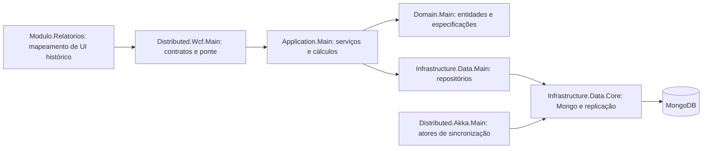

# Reconstrução e auditoria do instalador DigiSat — 30/10/2026

**Etapa posterior concluída:** [RC6 publicada e recompilação completa de Data.Core/classe de relatórios](rc6-e-recompilacao-2026-10-30.md). Os blockers abaixo registram a primeira etapa e foram parcialmente superados.

Follow-up: [stronger synchronization replica](bugs-sincronizacao-prototipo-2026-10-30.md) and [production-validation checklist / independent Insight calculations](validacao-reconstrucao-e-auditoria-independente.md) extend this first-pass report.

**Resultado:** reconstruídos oito tipos do instalador em cinco assemblies; ampliada a confirmação do defeito de concorrência para três totalizadores; demonstrado um erro novo de preço unitário fracionado e dois problemas nas expressões de sincronização. Foi gerada uma DLL experimental com quatro métodos alterados e um helper novo. O Insight passou a identificar as rotinas afetadas como candidatas de revisão, sem afirmar a versão do servidor remoto e sem recalcular silenciosamente seus resultados.

O escopo é uma investigação direcionada, não uma auditoria completa do SuiteG6. A DLL experimental não foi instalada nem executada como aplicação DigiSat. A reconstrução C# integral do serviço de relatórios ainda não compila por expressões geradas que o descompilador não reconstruiu corretamente. O arquivo [compile-report-service.log](../engenharia/reconstrucao-2026-10-30/compile-report-service.log) preserva essa limitação.

## Como foi possível no Linux

O instalador é um arquivo autoextraível WinRAR. O `bsdtar` existente lê seus membros sem executar o instalador. `Instalador/DATA0001.CAB`, apesar da extensão, contém gzip com registros de nome UTF-16LE, tamanho e bytes. A extração foi feita por streaming.

As bibliotecas selecionadas são assemblies .NET. Seus metadados identificam tipos, membros, referências e instruções CIL; ler essas estruturas não exige Windows. ILSpy reconstrói C# a partir delas. Roslyn compila os programas de laboratório, e Mono.Cecil reescreve a DLL experimental. O runtime portátil .NET 8 executa os ensaios isolados. Essas ferramentas não substituem Windows para homologar WPF, serviços WCF, drivers, periféricos e a aplicação completa em .NET Framework.

Nenhum SDK, Wine, Windows, VM, MongoDB ou pacote de sistema foi instalado. Os hashes e versões das ferramentas estão em [tool-manifest.json](../engenharia/reconstrucao-2026-10-30/tool-manifest.json).

## O que a reconstrução representa

Esta é a separação lógica observada nos assemblies e namespaces, não a estrutura original de pastas da equipe de desenvolvimento:



O inventário de 138 DLLs do primeiro payload, mais uma dependência MVVM extraída diretamente do arquivo externo (139 DLLs ao todo) ocupa aproximadamente 96 MiB. Os outros payloads do instalador não foram extraídos. Cada DLL foi conferida contra o inventário da etapa anterior; [assemblies.json](../engenharia/reconstrucao-2026-10-30/assemblies.json) registra os hashes. O hash do instalador é `c942724dfaf7e3df5d08f8558e64ad9395635f3384cfcaf0993476e65239d569`.

Tipos reconstruídos novamente nesta etapa:

| Assembly | Tipo recuperado |
| --- | --- |
| Application.Main | `MovimentacaoSaidaRelatorioAppService` |
| Domain.Main | `MovimentacaoSpecification` |
| Infrastructure.Data.Main | `MovimentacaoRepositoryRead` |
| Infrastructure.Data.Core | `CollectionReplicator`, `OpLogTail`, `MongoOperation`, `Operations` |
| Distributed.Akka.Main | `SincronizacaoServerActor` |

Os [fontes recuperados](../engenharia/reconstrucao-2026-10-30/recovered/) mantêm seus namespaces. [source-manifest.json](../engenharia/reconstrucao-2026-10-30/source-manifest.json) vincula cada arquivo ao assembly e ao hash do texto. Comentários, nomes locais, layout de projeto e sintaxe original não são recuperáveis com fidelidade literal. Expressões `<>...` não resolvidas são limitações da reconstrução, não bugs do aplicativo.

## Achados demonstrados

### DS-001 — Três totalizadores modificam arrays compartilhados

No `DigisatServer.Application.Main.dll`, SHA-256 `471908afa8e8ae43aaab13722e7820006c4b7a221600983abc42e9c3b9039af4`, foram confirmados:

| Rotina | Token original do callback |
| --- | --- |
| `ObterTotalMovimentacoesPorMesPorVendedor` | `0x0600328A` |
| `TotalMovimentadoPorVendedor` | `0x06003367` |
| `ObterTotalMovimentacoesPorMesPorTipo` | `0x060033EE` |

Os três callbacks de `AddOrUpdate` somam em `existing[i]` e devolvem a mesma referência. O dicionário concorrente não protege os elementos do array. Esse é o mesmo mecanismo já demonstrado no relatório mensal, agora conferido também em duas rotinas adicionais.

A DLL experimental clona o array no início de cada callback e executa a soma original sobre a cópia. Essa alternativa preserva o corpo da soma, mas publica uma referência nova. Os arrays publicados não podem ser modificados posteriormente por outros consumidores.

Os três callbacks foram extraídos da DLL reconstruída, traduzidos com metadados equivalentes e executados em laboratório: **120 ensaios paralelos passaram**, com graus 1, 2, 3 e 8. Cada ensaio soma 10.000 parciais em doze meses e compara todos os valores exatos. O ensaio também comprova que o array de entrada permanece intacto. Não foi executado o serviço completo de relatórios.

### DS-002 — Quantidade menor que uma unidade reduz indevidamente o preço unitário

Em `ObterItensVendidos`, quando `agruparPorValorUnitario=false`, o callback original `0x0600330C`, `<ObterItensVendidos>b__23`, contém três usos de:

```csharp
total / Math.Max(1m, quantidade)
```

Eles afetam `Preco`, `PrecoBruto` e o preço encaminhado ao detalhe de abastecimentos. Com quantidade de **0,5** e total de **10**, o resultado é **10 por unidade**, embora a razão correta seja **20 por unidade**. A quantidade do domínio é decimal; itens fracionados são representáveis.

A correção experimental troca somente esses três `Math.Max` por um helper que usa o fallback apenas se a quantidade for zero:

```csharp
quantidade == 0m ? fallback : quantidade
```

O teste confirma o caso fracionado, zero e quantidade negativa, e verifica os três pontos de chamada na DLL reconstruída. O tratamento de zero mantém o fallback anterior de 1; uma política de preço indefinido/zero deve ser decidida no produto. Valores negativos são preservados matematicamente, sem nova decisão sobre a admissibilidade de vendas negativas. O ensaio de preço reproduz a expressão e executa o helper reconstruído; não executa todo o selector com entidades reais.

Evidência REA: [price-evidence.json](../engenharia/reconstrucao-2026-10-30/price-evidence.json), parent `ev_e4575a143eda3b4a100dfc0908c3d07739cd75966aad91f1db9b809fc0d6494c`.

### DS-003 — O overload de replicação direta usa o seletor errado para exclusões

No `DigisatServer.Infrastructure.Data.Core.dll`, SHA-256 `c848fb91ea7394a94e9302645fdcb19022efdd8de12a7257179794ecb1f485d8`, o callback `0x06000170`, do overload `CollectionReplicator.To(IMongoCollection<BsonDocument>, ...)`, acessa:

```csharp
o.Source["o2"]["_id"]
```

O registro de exclusão usa `o` como seletor. Isso é corroborado pelo [código oficial do MongoDB 3.4.24](https://github.com/mongodb/mongo/blob/r3.4.24/src/mongo/db/repl/oplog.cpp#L900): o aplicador de exclusão lê `o`, enquanto updates usam `o2`.

O `MongoOperation` do instalador foi recompilado **sem alterações**, junto com o enum recuperado. Seu construtor mantém `Source=operation` e `Data=operation["o"]`; não há normalização que crie `o2`. Com um documento sintético de exclusão, a expressão recuperada lança `KeyNotFoundException`, enquanto `o.Data["_id"]` recupera o identificador esperado.

**Limite:** o servidor de sincronização examinado chama outro overload, voltado a atores. Não foi demonstrado que este overload direto é usado pelo cliente do incidente. A correção de seletor é proposta no fonte, mas não foi aplicada à DLL experimental de relatórios.

### DS-004 — Replay exclui operações posteriores à primeira no segundo final

`OpLogTail.RunBetween`, token `0x0600003F`, constrói o limite superior como:

```csharp
new BsonTimestamp(segundosInteirosDeFim, 1)
```

e consulta `ts <= limite`. Timestamps BSON contêm segundos e um ordinal de operações dentro daquele segundo, conforme a [documentação oficial](https://www.mongodb.com/docs/manual/reference/bson-types/#timestamps).

Para um fim às `...00.900`, um registro `Timestamp(...00, 2)` é excluído por essa expressão. O teste utiliza o comparador da biblioteca BSON extraída do instalador. A chamada de reconexão em `SincronizacaoServerActor` passa `DateTime.Now`, portanto o uso de uma hora com fração de segundo é relevante.

**Limite:** timestamps BSON não permitem inferir a hora exata de cada ordinal dentro do segundo. Um replay conservador pode incluir todo o segundo final, com limite exclusivo no início do segundo seguinte e tratamento idempotente de sobreposição. Isso pode incluir operações posteriores ao instante solicitado. A omissão no intervalo foi comprovada; perda líquida de dados, diante do fluxo ao vivo e dos checkpoints, não foi comprovada. Não foi alterada a sincronização.

As provas de DS-003 e DS-004 estão em [SyncProofs.cs](../engenharia/reconstrucao-2026-10-30/SyncProofs.cs) e [sync-proofs.json](../engenharia/reconstrucao-2026-10-30/sync-proofs.json). Elas não executam MongoDB, Rx, atores ou serviços.

## Hipóteses e limites mantidos em aberto

- O overload de atores `CollectionReplicator.To(IEnumerable<ICanTell>, ...)`, callback `0x06000172`, encaminha apenas insert/update e pode avançar checkpoint sem encaminhar exclusões. O comportamento é estático e demonstrável; sua classificação como bug depende da política de exclusão física versus lógica. Não foi criado um protocolo de exclusão sem validar o receptor.
- A carga completa do `SincronizacaoServerActor` encerra uma coleção vazia sem enviar a primeira mensagem que sinaliza limpeza. A condição foi reconferida no servidor do instalador. O receptor desta versão não foi extraído novamente nesta etapa; o efeito completo sobre dados antigos continua hipótese de integração.
- Há participações percentuais divididas por soma sem guarda de zero. O erro aritmético é previsível para uma entrada não vazia de soma zero; a admissibilidade e o caminho de dados precisam de casos de negócio antes de um patch.
- `UltimaVenda` usa o último elemento de uma sequência em outra rotina. Falta demonstrar sua ordenação efetiva.
- A paginação mensal usa `Skip/Limit` sem snapshot nem ordenação explícita no método recuperado do repositório. Alterações simultâneas dos dados podem afetar a leitura; isso não explica as falhas já demonstradas com entrada congelada nem comprova duplicação em um banco estável.
- Foi descartada a suspeita de exclusão automática de 31 de dezembro pelo construtor do período: `MovimentacaoSpecification.PorDataEmissao` aplica `.Date` no início e `ToFinalDia()` no fim.

Esses pontos não foram contados como novos defeitos integralmente confirmados no cliente.

## O que foi recompilado e verificado

1. `MongoOperation.cs` e `Operations.cs`, recuperados novamente, compilam e executam no programa `SyncProofs`.
2. O **método mensal completo** também compila em C# nas versões recuperada e corrigida, contra as interfaces reais de domínio/repositório do instalador, sem stubs. O [fonte recuperado compilável](../engenharia/reconstrucao-2026-10-30/RecoveredMonthlyReportService.cs) copia o método sem alterações; a classe, namespace, campos e construtor de isolamento são novos. O [fonte corrigido](../engenharia/reconstrucao-2026-10-30/RecoveredMonthlyReportService.fixed.cs) clona o array no início do callback. [source-rebuild.json](../engenharia/reconstrucao-2026-10-30/source-rebuild.json) registra os dois DLLs e hashes, e [method-source-match.json](../engenharia/reconstrucao-2026-10-30/method-source-match.json) comprova a cópia textual. Esse método completo foi **compilado**, mas não executado contra os repositórios reais.
3. As ferramentas do laboratório e os testes CIL compilam com Roslyn. Dois projetos SDK estão disponíveis para quem possui SDK: [SyncProofs.csproj](../engenharia/reconstrucao-2026-10-30/SyncProofs.csproj) e [Workshop.Tools.csproj](../engenharia/reconstrucao-2026-10-30/Workshop.Tools.csproj). Nesta máquina foi usado o runner sem SDK.
4. A tentativa de compilar a classe completa `MovimentacaoSaidaRelatorioAppService` falha nas expressões geradas preservadas pelo decompilador. Essa etapa não foi apresentada como concluída.
5. Mono.Cecil reescreveu a DLL completa de aplicação com os quatro métodos selecionados e um helper novo. Isso é **reconstrução em CIL**, não compilação completa do código-fonte original.

Artefato local: [DigisatServer.Application.Main.experimental.dll](../engenharia/reconstrucao-2026-10-30/build/DigisatServer.Application.Main.experimental.dll).

- SHA-256: `e4cd8f5ef26b63cfec9a066ad44dc28dab6b8cf54c9911122cdad16e040554bc`.
- MVID novo: `75a4604e-19a7-1193-fc9e-a5d9f960feb2`.
- Quatro métodos originais alterados; seis pontos de correção.
- **14.798 outros métodos** mantêm instruções, variáveis locais, flags e regiões de exceção na comparação normalizada por identidade.
- Referências de assemblies, identidades/flags de campos e payloads de recursos embutidos permanecem iguais nas verificações implementadas.
- Tokens mudam durante a escrita; use nomes completos e os manifests para comparar builds.
- Timestamp PE fixado em zero e MVID derivado da entrada/versão da correção permitem saída determinística; duas escritas independentes produziram o mesmo hash, registrado em [deterministic-build.json](../engenharia/reconstrucao-2026-10-30/deterministic-build.json).

[rebuild-manifest.json](../engenharia/reconstrucao-2026-10-30/rebuild-manifest.json) e [rebuilt-tests.json](../engenharia/reconstrucao-2026-10-30/rebuilt-tests.json) registram a comparação e os ensaios. O [bundle REA completo](../engenharia/reconstrucao-2026-10-30/rea-evidence.json.gz) preserva 25 registros desta sessão. REA reconferiu a metadata da DLL resultante, com cobertura completa e sem issues: [rebuilt-identity.json](../engenharia/reconstrucao-2026-10-30/rebuilt-identity.json).

Essas verificações não cobrem toda a metadata nem demonstram que proteções do aplicativo, referências externas a tokens, WPF, WCF e o runtime .NET Framework aceitam o binário no sistema completo. O nome `experimental` e o diretório `build/` mantêm o artefato separado da instalação. Não foi publicado um build de produção.

## Melhoria aplicada ao Insight

[insight_upstream_issues.py](../insight_upstream_issues.py) registra as rotinas e o hash analisado. O catálogo nativo expõe os candidatos por chamada. A consulta acrescenta avisos em português e `upstream_issues`, com condição de argumentos, identidade do artefato analisado e `remote_build_status=unverified`.

O aviso de preço depende do agrupamento; com `agruparPorValorUnitario=true`, ele não é acrescentado. A identidade do servidor e as condições dos dados permanecem não verificadas. Nem um hash local nem o catálogo comprovam qual DLL o servidor WCF remoto executa. O resultado nativo, incluindo preços e decimais, é mantido. A interface já exibe a lista de avisos; nenhum CSS ou layout foi alterado.

**17 testes passaram**, cobrindo os avisos novos e a integração nativa existente. A execução usou `/tmp/digisat-insight-tests/bin/python -m unittest tests.test_upstream_issues tests.test_native`, sem banco ou servidor DigiSat.

## Repetir a investigação

```sh
python engenharia/reconstrucao-2026-10-30/extract_server.py DigisatInstalador.exe
python engenharia/reconstrucao-2026-10-30/run_workshop.py /tmp/digisat-monthly
```

O primeiro comando usa apenas Python e `bsdtar`, valida os hashes e não executa o instalador. O segundo usa runtime, compilador, ILSpy e Mono.Cecil já fornecidos em `/tmp`; não faz downloads. Compila as ferramentas, reescreve em um diretório temporário privado, verifica os outros métodos e executa as provas antes de atualizar o artefato experimental. Não substitui DLLs de instalação.

Fontes podem ser decompilados com o driver gerado:

```sh
/tmp/digisat-monthly/runtime/dotnet \
  engenharia/reconstrucao-2026-10-30/build/DecompilerDriver.dll \
  engenharia/reconstrucao-2026-10-30/assemblies/DigisatServer.Infrastructure.Data.Core.dll \
  DigisatServer.Infrastructure.Data.Core.MongoOperation \
  /tmp/MongoOperation.cs
```

## Estado das perguntas

| Pergunta | Estado |
| --- | --- |
| Estrutura lógica e fontes relevantes | Oito tipos recuperados em cinco assemblies; restante do sistema não reconstruído |
| Concorrência e preço fracionado | Confirmados no build e reproduzidos no escopo descrito |
| Seletor de delete e intervalo de replay | Expressões defeituosas reproduzidas; impacto no cliente ainda não demonstrado |
| Recompilar código recuperado | Dois tipos e o método mensal completo (original/corrigido, interfaces reais) compilados; classe inteira de relatórios ainda não compila |
| Gerar DLL com correções isoladas | Concluído por reescrita CIL, com verificações e testes; somente laboratório |
| Melhorar Insight com os achados | Concluído no backend, 17 testes passaram |
| Compilar/homologar toda a aplicação original | Não concluído; requer mais reconstrução, dependências e ambiente Windows representativo |
